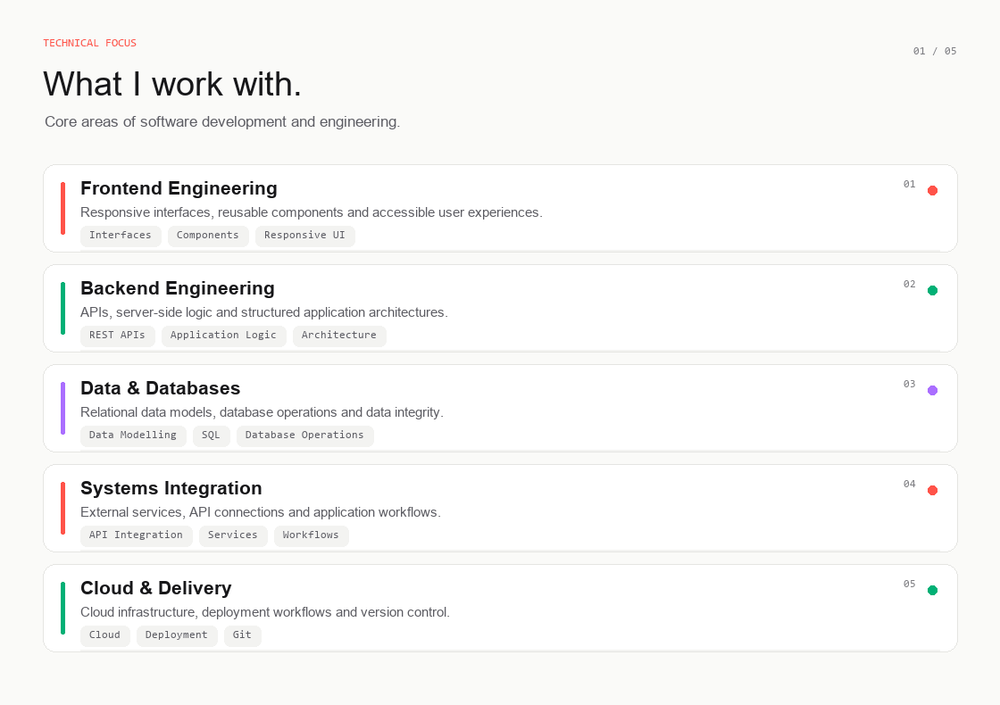

  

<h2 align="center">Technical Focus</h2>

  

## Development Activity

I maintain an active development practice through personal projects, technical experiments, and collaborative work. My activity reflects ongoing work across frontend development, backend systems, API integration, and application architecture.

  
  

  <a href="https://github.com/StevetheRebel">
    View my GitHub activity and repositories
  </a>

<h3 align="center">Contribution Activity</h3>

  

